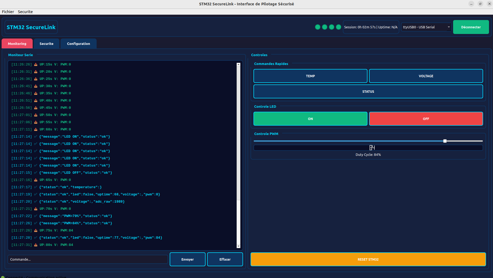
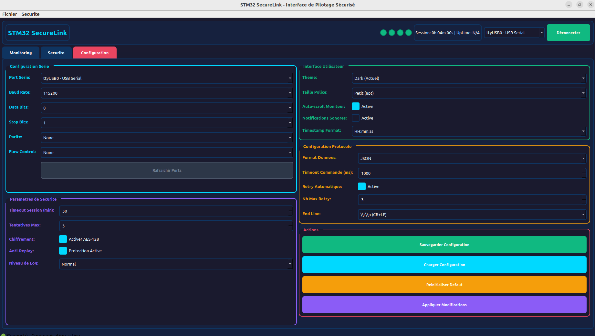
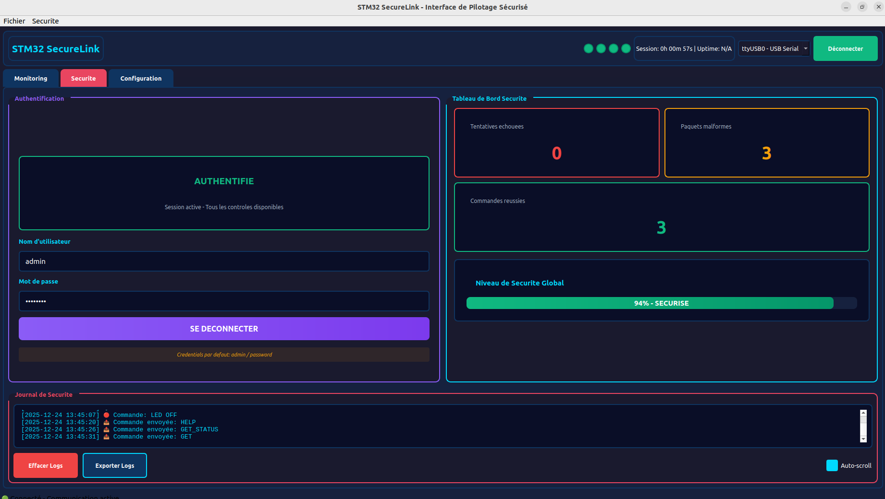

# STM32 Control Suite

[](https://github.com/BechirYengui/qt_interface_stm32)
[](https://github.com/BechirYengui/stm32_bootloader-application)
[](https://github.com/BechirYengui/stm32-control-suite)

End-to-end embedded system combining a secure STM32 firmware and a C++/Qt desktop interface for real-time monitoring and control.

## Overview

Active development since September 2025 — consolidated in May 2026 from the desktop predecessor [qt_interface_stm32](https://github.com/BechirYengui/qt_interface_stm32) (archived). The secure firmware is developed in [stm32_bootloader-application](https://github.com/BechirYengui/stm32_bootloader-application) and vendored here under `firmware/`. See [Project History](#project-history) for details.

This monorepo contains two complementary projects:

- **`firmware/`** — STM32F103 secure firmware: a bootloader that verifies the application with an **RSA-2048 (PKCS#1 v1.5 over SHA-256) signature** and **anti-rollback** protection (CRC32 is kept as an integrity guard), and an application layer exposing a JSON/TEXT command protocol over UART (LED, PWM, ADC).
- **`desktop/`** — C++/Qt graphical interface to control and monitor the STM32 in real time over a serial link, with MVC architecture and JSON-based protocol.

## Architecture

```
┌─────────────────────────┐         ┌──────────────────────────┐
│    Desktop (Qt / C++)   │  UART   │      STM32F103           │
│                         │ <─────> │                          │
│  - MVC architecture     │  JSON   │  - RSA-2048 secure boot  │
│  - QThread serial I/O   │ 115200  │  - JSON/TEXT app layer   │
│  - Real-time dashboards │         │  - Peripherals (LED/PWM) │
└─────────────────────────┘         └──────────────────────────┘
```

## Screenshots

<table>
<tr>
<td colspan="2"></td>
</tr>
<tr>
<td colspan="2" align="center"><i>Real-time monitoring and device control</i></td>
</tr>
<tr>
<td></td>
<td></td>
</tr>
<tr>
<td align="center"><i>Serial, security and protocol settings</i></td>
<td align="center"><i>Authentication and security event logging</i></td>
</tr>
</table>

## Repository Structure

```
stm32-control-suite/
├── firmware/                 # STM32 firmware (C, PlatformIO)
│   ├── bootloader/           # Secure bootloader (8 KB)
│   └── application/          # Encrypted application (48 KB)
├── desktop/                  # Qt C++ control interface
│   ├── src/                  # MVC source code
│   └── docs/                 # Architecture & migration notes
└── docs/                     # Global documentation
    ├── screenshots/
    └── diagrams/
```

## Tech Stack

| Layer | Technologies |
|-------|--------------|
| Desktop | C++17, Qt 5.15+, CMake, QSerialPort, QThread, JSON |
| Firmware | C, STM32 HAL, PlatformIO, RSA-2048 (PKCS#1 v1.5), SHA-256, anti-rollback, CRC32 |
| Protocol | UART 115200 bps, JSON/TEXT framing |

## Getting Started

See the dedicated READMEs:

- [Desktop application](desktop/README.md)
- [STM32 firmware](firmware/README.md)

## Project Highlights

- **Modern C++ architecture**: MVC, RAII, STL, smart pointers, multi-threading
- **Embedded security**: RSA-2048 signed secure boot chain, SHA-256 image hashing, anti-rollback counter
- **Production-grade tooling**: CMake, PlatformIO, unit tests, Doxygen documentation
- **Cross-disciplinary**: hardware-level firmware to desktop UI, end-to-end ownership

## Project History

This monorepo is the consolidation of two repositories actively developed since September 2025 as personal projects:

- **[qt_interface_stm32](https://github.com/BechirYengui/qt_interface_stm32)** (archived) — Qt desktop interface for STM32 control. Initial commits: September 2025. Superseded by `desktop/` in this repository.
- **[stm32_bootloader-application](https://github.com/BechirYengui/stm32_bootloader-application)** (active) — STM32 secure bootloader with an RSA-2048 (PKCS#1 v1.5 / SHA-256) signature check and anti-rollback protection. Initial commits: September 2025. This remains the upstream for the `firmware/` directory, which is vendored here.

The monorepo unifies both subsystems under a shared structure with consistent build tooling and documentation. The archived desktop repository remains publicly accessible and preserves the original development history; the firmware stays maintained in its own repository and is mirrored here.

## License

MIT — see [LICENSE](LICENSE).

## Author

**Bechir Yengui** — [github.com/BechirYengui](https://github.com/BechirYengui)
