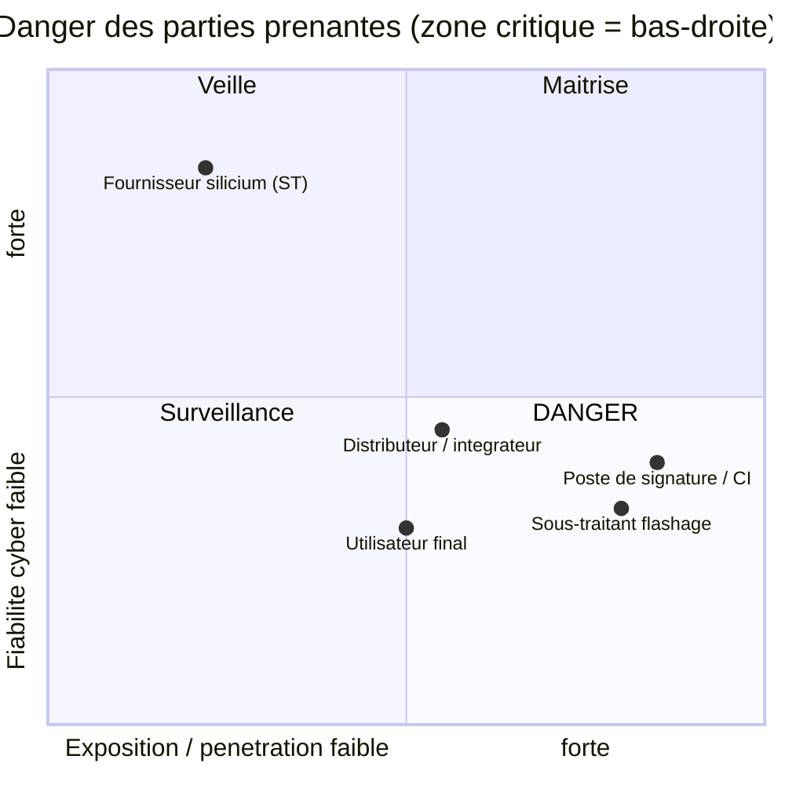
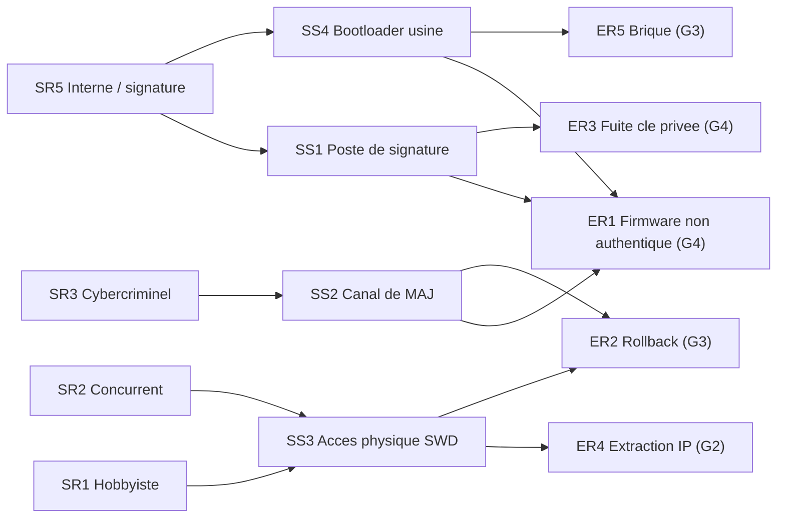
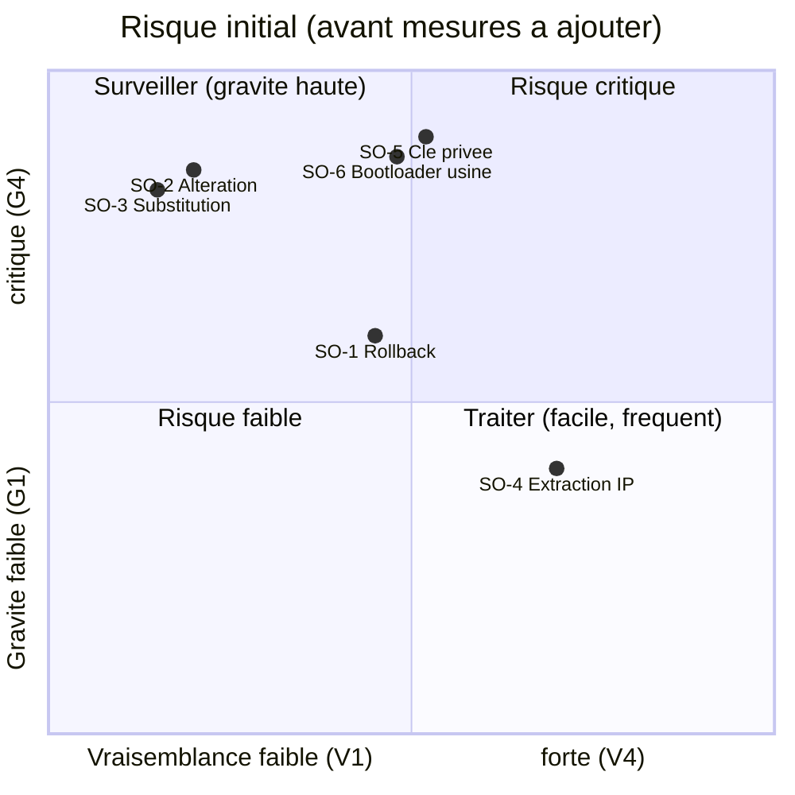

# Analyse de risque — EBIOS Risk Manager
### Système de *secure boot* STM32F103 et chaîne de signature

| | |
|---|---|
| **Objet** | Analyse de risque du secure boot STM32F103 (racine de confiance, firmware signé) et de sa chaîne de signature/déploiement |
| **Méthode** | EBIOS Risk Manager — ANSSI (5 ateliers) |
| **Auteur** | Bechir Yengui |
| **Version** | 1.0 |
| **Date** | 2026-10-31 |
| **Classification** | Interne — démonstration / portfolio |
| **Statut** | Analyse individuelle (hors atelier collectif — cf. [annexe B](#annexe-b--limites-de-cette-analyse)) |
| **Documents liés** | [`THREAT_MODEL.md`](THREAT_MODEL.md) (modèle de menaces technique, type STRIDE, adossé à des tests) |

> **Positionnement.** Ce document se place au **niveau système/organisationnel** (biens,
> sources de risque, écosystème, scénarios). Il **complète** le modèle de menaces technique
> `THREAT_MODEL.md` (niveau produit) ; la correspondance entre les deux est donnée en
> [annexe A](#annexe-a--correspondance-ebios-rm--modèle-de-menaces-technique).

---

## Sommaire

- [Préambule — méthode et échelles](#préambule--méthode-et-échelles)
- [Atelier 1 — Cadrage et socle de sécurité](#atelier-1--cadrage-et-socle-de-sécurité)
- [Atelier 2 — Sources de risque et objectifs visés](#atelier-2--sources-de-risque-et-objectifs-visés)
- [Atelier 3 — Scénarios stratégiques](#atelier-3--scénarios-stratégiques) *(fig. 1 écosystème, fig. 2 chemins d'attaque)*
- [Atelier 4 — Scénarios opérationnels](#atelier-4--scénarios-opérationnels)
- [Atelier 5 — Traitement du risque](#atelier-5--traitement-du-risque) *(fig. 3 matrice de risque)*
- [Annexe A — Correspondance EBIOS RM ↔ modèle technique](#annexe-a--correspondance-ebios-rm--modèle-de-menaces-technique)
- [Annexe B — Limites de cette analyse](#annexe-b--limites-de-cette-analyse)

---

## Préambule — méthode et échelles

EBIOS RM se déroule en **5 ateliers** :

1. **Cadrage et socle de sécurité** — objet, biens métier/supports, événements redoutés, référentiels.
2. **Sources de risque (SR) et objectifs visés (OV)**.
3. **Scénarios stratégiques** — écosystème, parties prenantes, chemins d'attaque macro.
4. **Scénarios opérationnels** — chemins techniques détaillés, vraisemblance.
5. **Traitement du risque** — mesures, risque résiduel, plan d'amélioration.

### Échelle de gravité (impact)

| Niveau | Libellé | Signification pour ce produit |
|---|---|---|
| **G1** | Mineure | Gêne limitée, pas d'impact sur la sécurité du produit |
| **G2** | Significative | Perte de confidentialité du firmware (IP), image de marque |
| **G3** | Grave | Indisponibilité (brique), retour à une version vulnérable |
| **G4** | Critique | Exécution de code non autorisé à grande échelle, perte de la racine de confiance |

### Échelle de vraisemblance

| Niveau | Libellé | Repère |
|---|---|---|
| **V1** | Peu vraisemblable | Nécessite des moyens rares (labo, physique invasif) |
| **V2** | Vraisemblable | Attaquant outillé, accès logique/physique ponctuel |
| **V3** | Très vraisemblable | Chemin connu, outils publics (ST-Link, scripts) |
| **V4** | Quasi-certain | Exploitable sans compétence particulière |

### Niveau de risque (gravité × vraisemblance)

| | V1 | V2 | V3 | V4 |
|---|---|---|---|---|
| **G4** | Moyen | Élevé | Critique | Critique |
| **G3** | Faible | Moyen | Élevé | Critique |
| **G2** | Faible | Moyen | Moyen | Élevé |
| **G1** | Faible | Faible | Faible | Moyen |

---

## Atelier 1 — Cadrage et socle de sécurité

### 1.1 Objet de l'étude

Système embarqué STM32F103C8 exécutant un firmware **signé**, protégé par un
**bootloader racine de confiance**, piloté par une interface desktop via UART. Le
périmètre inclut la **chaîne de signature et de déploiement** (génération de clés,
signature de l'image, flashage).

### 1.2 Biens métier (valeurs métier)

| Id | Bien métier | Besoin de sécurité dominant |
|---|---|---|
| **BM1** | Exécution d'un firmware **authentique et intègre** sur le MCU | Intégrité, Authenticité |
| **BM2** | **Processus de mise à jour** du firmware (cycle de vie) | Intégrité, Disponibilité |
| **BM3** | **Propriété intellectuelle** du firmware (code) | Confidentialité |
| **BM4** | **Chaîne de confiance de signature** (clé privée) | Confidentialité, Intégrité |

### 1.3 Biens supports

| Id | Bien support | Porte quel(s) bien(s) métier |
|---|---|---|
| **BS1** | Bootloader (`0x08000000`, 8 Ko) — **racine de confiance** | BM1 |
| **BS2** | Zone application + métadonnées + signature (`0x08002000`, `0x0800E000`) | BM1, BM3 |
| **BS3** | Compteur anti-rollback (page Flash `0x0800E800`) | BM1, BM2 |
| **BS4** | Clé **privée** de signature (poste dev / idéalement HSM) | BM4 |
| **BS5** | Clé **publique** embarquée (`include/rsa_public_key.h`) | BM1 |
| **BS6** | Interface de debug **SWD/ST-Link** | BM1, BM3 (surface d'attaque) |
| **BS7** | Canal de mise à jour (UART + desktop) | BM2 |
| **BS8** | **Option bytes** (RDP / WRP) | BM1, BM3 |
| **BS9** | Chaîne **CI/CD** et poste de signature | BM4 |

> **Hypothèse fondatrice :** le bootloader (BS1) est la **racine de confiance**. On le
> suppose intègre, flashé en usine et idéalement verrouillé en écriture (WRP). Toute la
> sécurité du système repose sur cette hypothèse.

### 1.4 Événements redoutés (ER)

| Id | Événement redouté | Bien métier | Gravité |
|---|---|---|---|
| **ER1** | Exécution d'un firmware **non authentique** (malveillant) sur le MCU | BM1 | **G4** |
| **ER2** | **Retour à une version vulnérable** déjà corrigée (rollback) | BM1, BM2 | **G3** |
| **ER3** | **Vol / fuite de la clé privée** de signature | BM4 | **G4** |
| **ER4** | **Extraction du firmware** depuis la Flash (perte d'IP) | BM3 | **G2** |
| **ER5** | **Mise hors service** (brique) via corruption de la racine de confiance | BM1, BM2 | **G3** |

> **Justification des cotations de gravité :**
> - **ER1 → G4 (Critique)** : l'exécution de code arbitraire est la **compromission
>   totale** du produit (prise de contrôle, persistance), potentiellement reproductible
>   sur **toute la flotte** partageant la même clé publique. C'est l'événement que le
>   secure boot existe pour empêcher.
> - **ER2 → G3 (Grave)** : un rollback réintroduit une faille **déjà connue** ; l'impact
>   est réel mais **indirect** (il faut ensuite exploiter la faille) et borné aux cartes
>   atteintes — grave sans être critique.
> - **ER3 → G4 (Critique)** : la clé privée est le **secret racine** ; sa fuite permet de
>   signer n'importe quelle image pour **toutes** les cartes et rend ER1 trivial. Gravité
>   maximale, d'autant que la **révocation sur le terrain est difficile** (cf. Q15 / §5.3).
> - **ER4 → G2 (Significative)** : perte de **confidentialité/IP** (reverse, clonage), mais
>   **sans atteinte à l'intégrité d'exécution** : la carte continue de ne booter que du
>   code signé. Impact patrimonial/image, pas sécurité fonctionnelle.
> - **ER5 → G3 (Grave)** : atteinte à la **disponibilité** (produit briqué) ; coûteux et
>   gênant, mais **pas d'exécution malveillante** — on dégrade, on ne détourne pas.

### 1.5 Socle de sécurité (référentiels)

- **Guides ANSSI** sur le *secure boot* et l'administration des secrets (clés).
- **IEC 62443** (sécurité des systèmes industriels) pour la posture cycle de vie, si usage industriel.
- Bonnes pratiques **cryptographiques** (RGS/ANSSI) : tailles de clés, algorithmes.
- **Écart principal connu** : en l'état de développement, **RDP = niveau 0** et **WRP non activé** → écart à corriger pour la production (voir Atelier 5).

---

## Atelier 2 — Sources de risque et objectifs visés

### 2.1 Couples Source de Risque / Objectif Visé (SR/OV)

| Id | Source de risque | Objectif visé | Motivation | Ressources | Pertinence |
|---|---|---|---|---|---|
| **SR1** | Hobbyiste / chercheur | Reverse engineering, « jailbreak » | Curiosité, défi | Faibles (ST-Link, outils publics) | **Retenu** |
| **SR2** | Concurrent / contrefacteur | Cloner le firmware, produire des copies | Gain économique | Moyennes | **Retenu** |
| **SR3** | Cybercriminel | Implanter un firmware malveillant (botnet, rançon) via le canal de MAJ | Gain financier | Moyennes à fortes | **Retenu (prioritaire)** |
| **SR4** | Attaquant étatique / APT | Implant persistant, attaque ciblée | Renseignement, sabotage | Très fortes (labo, physique invasif) | **Partiellement** (physique = hors périmètre) |
| **SR5** | Interne malveillant (accès poste de signature / CI) | Signer un firmware illégitime | Sabotage, corruption | Accès privilégié | **Retenu (prioritaire)** |

### 2.2 Couples retenus pour la suite

- **SR3 / implanter un firmware malveillant via le canal de MAJ** — le scénario le plus probable à distance.
- **SR5 / signer une image illégitime via le poste de signature** — contourne *toute* la crypto embarquée (vise BS4/BS9).
- **SR2 / cloner le firmware** (vise BM3 via BS6, extraction Flash).
- **SR1** conservé comme bruit de fond (extraction, rollback opportuniste).

> SR4 (physique invasif : *fault injection*, *glitching*, *decap*) est **explicitement
> hors périmètre** du présent modèle logiciel, cohérent avec l'hypothèse de l'Atelier 1.

> **Justification de la priorisation :**
> - **SR3 (cybercriminel) — prioritaire** : c'est la seule source qui agit **à distance et
>   à l'échelle**, via le canal de mise à jour. Combinaison coût modéré × impact G4 ×
>   population large ⇒ pertinence maximale.
> - **SR5 (interne / poste de signature) — prioritaire** : il **court-circuite toute la
>   crypto embarquée** en obtenant une signature *légitime*. Faible vraisemblance brute
>   mais impact G4 et aucune barrière technique côté MCU ⇒ à traiter en priorité.
> - **SR1 (hobbyiste) — retenu** : coût très faible, outils publics (ST-Link), donc
>   **forte accessibilité** ; vise surtout l'extraction/rollback opportuniste (gravité
>   moindre), d'où un rôle de « bruit de fond » constant.
> - **SR2 (concurrent) — retenu** : motivation **économique** claire sur un produit
>   commercialisé (clonage) ; moyens moyens, cible l'IP (BM3).
> - **SR4 (étatique) — partiellement** : capacités très fortes mais son mode opératoire
>   privilégié (physique invasif) est **assumé hors périmètre** ; le retenir pleinement
>   fausserait les cotations sans que le code puisse y répondre. On le mentionne pour la
>   traçabilité de la décision.

---

## Atelier 3 — Scénarios stratégiques

### 3.1 Cartographie de l'écosystème (parties prenantes)

Évaluation du **niveau de danger** de chaque partie prenante selon : **Dépendance**
(à quel point on en dépend), **Pénétration** (accès qu'elle a à nos biens),
**Maturité cyber** et **Confiance**. (↑ dépendance/pénétration + ↓ maturité/confiance ⇒ ↑ danger.)

| Partie prenante | Dépendance | Pénétration | Maturité | Confiance | **Danger** |
|---|---|---|---|---|---|
| **Poste de signature / CI-CD** (BS9) | Forte | Forte (détient la clé) | Moyenne | Moyenne | **Élevé** |
| **Sous-traitant de flashage usine** | Forte | Forte (flashe la racine) | Variable | Moyenne | **Élevé** |
| Fournisseur silicium (ST) | Forte | Faible | Forte | Forte | Faible |
| Distributeur / intégrateur | Moyenne | Moyenne (canal MAJ) | Variable | Moyenne | **Moyen** |
| Utilisateur final | Faible | Moyenne (accès physique carte) | Faible | Faible | **Moyen** |

→ **Parties prenantes critiques** : le **poste de signature/CI** et le **sous-traitant de flashage**. Ce sont les chemins qui permettent de contourner la racine de confiance *sans* casser la crypto.

**Figure 1 — Cartographie de l'écosystème.** Position selon l'**exposition/pénétration**
(axe X) et la **fiabilité cyber** (axe Y). Le quadrant en bas à droite (forte exposition ×
faible fiabilité) est la **zone de danger** : on y retrouve les parties prenantes critiques.

> **Justification des niveaux de danger :**
> - **Poste de signature / CI (Élevé)** : il **détient la clé privée** (pénétration
>   maximale) et on en dépend pour chaque release (dépendance forte). Sa maturité cyber
>   est souvent **moyenne** (secrets dans des pipelines, postes dev). Le produit du
>   « plus dépendant × plus pénétrant × moins mûr » donne le danger le plus élevé.
> - **Sous-traitant de flashage (Élevé)** : il **écrit la racine de confiance** en usine ;
>   une compromission à ce niveau rend toutes les protections aval **inopérantes**
>   (il peut flasher un bootloader piégé). Maturité variable ⇒ danger élevé.
> - **Fournisseur silicium ST (Faible)** : dépendance forte mais **pénétration quasi nulle**
>   sur nos biens une fois la puce intégrée, et **maturité/confiance élevées**.
> - **Distributeur / utilisateur final (Moyen)** : accès au **canal de MAJ** ou à la carte
>   physique, mais sans accès aux secrets ; maturité faible ⇒ danger intermédiaire.
>
> *Principe EBIOS RM : on ne note pas la « méchanceté » d'une partie prenante mais le
> **danger qu'elle fait porter** au système, combinaison de l'accès qu'elle a et de sa
> solidité cyber.*

### 3.2 Scénarios stratégiques

| Id | Scénario stratégique | SR/OV | ER visé | Gravité |
|---|---|---|---|---|
| **SS1** | Un attaquant compromet le **poste de signature / CI** et fait signer une image malveillante, qui est ensuite déployée comme légitime. | SR5, SR3 | ER1, ER3 | **G4** |
| **SS2** | Un attaquant exploite le **canal de mise à jour** pour pousser une image (malveillante ou ancienne) vers le MCU. | SR3 | ER1, ER2 | **G4 / G3** |
| **SS3** | Un attaquant à **accès physique** (SWD) lit la Flash et/ou reflashe une image. | SR1, SR2 | ER4, ER2, ER5 | **G2 / G3** |
| **SS4** | Un attaquant compromet le **sous-traitant de flashage** et altère le bootloader (racine de confiance) en usine. | SR5 | ER1, ER5 | **G4** |

**Figure 2 — Synthèse des chemins d'attaque.** Des sources de risque (SR) vers les
événements redoutés (ER), via les scénarios stratégiques (SS). Deux chemins mènent à
l'événement critique ER1 (firmware non authentique).

---

## Atelier 4 — Scénarios opérationnels

Décomposition des scénarios stratégiques en **chemins d'attaque** techniques, selon la
séquence *Connaître → Entrer → Trouver/Progresser → Exploiter*. La vraisemblance est
cotée **compte tenu des mesures déjà en place** (crypto embarquée).

### SO-1 — Rollback vers une version vulnérable *(dérivé de SS2 / ER2)*

| Étape | Action de l'attaquant |
|---|---|
| Connaître | Identifie qu'une ancienne image signée existe et contient une faille corrigée. |
| Entrer | Accès SWD/ST-Link ou canal de MAJ. |
| Progresser | Reflashe l'ancienne image + ses métadonnées (signature valide d'origine). |
| Exploiter | Espère réintroduire la faille. |

- **Mesure en place :** compteur `security_version` **monotone** → le bootloader refuse toute version strictement inférieure (`antirollback_allowed`).
- **Vraisemblance :** **V2** (le compteur Flash reste effaçable physiquement → voir risque résiduel).
- **Gravité :** G3 → **Risque : Moyen**.

### SO-2 — Altération de l'image *(dérivé de SS3 / ER1)*

| Étape | Action |
|---|---|
| Entrer | Accès à la zone application via SWD. |
| Progresser | Modifie quelques octets du firmware. |
| Exploiter | Tente de faire exécuter le code modifié. |

- **Mesure :** SHA-256 recalculé + **signature RSA-2048** vérifiée sur ce hash → la signature ne correspond plus.
- **Vraisemblance :** **V1** (nécessiterait de forger une signature).
- **Gravité :** G4 → **Risque : Moyen**.

### SO-3 — Substitution par une image forgée *(dérivé de SS2 / ER1)*

- L'attaquant flashe **son** firmware et génère métadonnées + « signature ».
- **Mesure :** sans la **clé privée**, impossible de produire une signature valide pour la clé publique embarquée (exposant figé 65537).
- **Vraisemblance :** **V1**. **Gravité :** G4 → **Risque : Moyen**.

### SO-4 — Extraction de l'IP firmware *(dérivé de SS3 / ER4)*

- Lecture de la Flash via SWD/ST-Link.
- **Mesure manquante :** **RDP niveau 0** en développement → la Flash est **lisible**.
- **Vraisemblance :** **V3** (outils publics, trivial). **Gravité :** G2 → **Risque : Moyen** *(mais le plus facile à réaliser)*.

### SO-5 — Compromission de la clé privée *(dérivé de SS1 / ER3)*

| Étape | Action |
|---|---|
| Connaître | Repère que la clé vit sur un poste dev / dans la CI. |
| Entrer | Phishing, compromission du poste, secret exposé dans un pipeline. |
| Exploiter | Signe une image malveillante **acceptée par tous les MCU**. |

- **Mesure en place :** clé privée **hors du dépôt** ; clé de démo seulement pour la reproductibilité.
- **Mesure manquante :** HSM, rotation, révocation.
- **Vraisemblance :** **V2**. **Gravité :** G4 → **Risque : Élevé** *(le scénario le plus dangereux : il court-circuite toute la crypto embarquée).*

### SO-6 — Altération du bootloader en usine *(dérivé de SS4 / ER1, ER5)*

- **Mesure manquante :** WRP sur la page bootloader.
- **Vraisemblance :** **V2**. **Gravité :** G4 → **Risque : Élevé**.

> **Justification des cotations de vraisemblance :**
> - **SO-2 / SO-3 → V1** : exigent de **forger une signature RSA-2048** valide pour la clé
>   publique embarquée. C'est **cryptographiquement infaisable** sans la clé privée ⇒
>   vraisemblance minimale *malgré* une gravité G4. C'est ici que la crypto embarquée
>   « paie » : elle n'abaisse pas la gravité mais **effondre la vraisemblance**.
> - **SO-4 → V3** : la lecture de la Flash via ST-Link en **RDP niveau 0** est **triviale**
>   (outils publics, quelques secondes). Rien dans le code ne l'empêche ⇒ vraisemblance
>   forte. C'est le scénario **le plus facile à réaliser**, d'où sa priorité de traitement
>   bien qu'il ne soit « que » G2.
> - **SO-1 → V2** : le rollback demande un accès SWD/MAJ **et** le reflash d'une ancienne
>   image signée ; l'anti-rollback le bloque, mais le compteur en **Flash reste effaçable**
>   physiquement ⇒ faisable mais non trivial.
> - **SO-5 → V2** : dépend de la **posture du poste de signature / CI** (hors MCU).
>   Réaliste (phishing, secret exposé) sans être automatique ⇒ V2, mais **gravité G4** ⇒
>   le risque monte à **Élevé**.
> - **SO-6 → V2** : nécessite une **compromission ciblée** de la chaîne de production
>   (flashage usine) ; peu d'acteurs, mais impact G4 sur la racine de confiance.
>
> *Règle appliquée : la vraisemblance est cotée **après** prise en compte des mesures
> déjà présentes — c'est pourquoi les scénarios contrés par la signature tombent à V1.*

---

## Atelier 5 — Traitement du risque

### 5.1 Synthèse des risques (avant / après mesures)

| Scénario | Risque **initial** | Mesures | Risque **résiduel** | Décision |
|---|---|---|---|---|
| SO-1 Rollback | Moyen (G3×V2) | Compteur monotone **+ ancrage OTP** | Faible | Réduire |
| SO-2 Altération | Moyen (G4×V1) | SHA-256 + RSA-2048 | Faible | Accepté |
| SO-3 Substitution | Moyen (G4×V1) | Signature RSA (clé privée hors carte) | Faible | Accepté |
| SO-4 Extraction IP | Moyen (G2×V3) | **RDP niveau 1/2** | Faible | Réduire |
| SO-5 Clé privée | **Élevé** (G4×V2) | **HSM + rotation + révocation** | Moyen | Réduire (prioritaire) |
| SO-6 Bootloader usine | **Élevé** (G4×V2) | **WRP** + flashage de confiance | Faible | Réduire (prioritaire) |

**Figure 3 — Matrice de risque initiale** (gravité × vraisemblance). Haut-droite =
critique. **SO-5** et **SO-6** ressortent en zone Élevé ; **SO-4** est « modéré mais
facile » (forte vraisemblance), d'où son traitement malgré une gravité G2.

> **Justification des décisions de traitement :**
> - **Accepter (SO-2, SO-3)** : risque déjà **Moyen** et surtout porté par une vraisemblance
>   **V1** qu'aucune mesure raisonnable n'améliorera (on ne « sécurise » pas plus que
>   l'infaisabilité cryptographique). Le coût d'une mesure supplémentaire serait
>   disproportionné ⇒ risque **accepté en l'état**.
> - **Réduire en priorité (SO-5, SO-6)** : seuls risques **Élevés** ; ils visent la **clé**
>   et la **racine de confiance**, c.-à-d. les points qui invalident *toute* la défense
>   aval. Priorité maximale même si leur vraisemblance n'est « que » V2.
> - **Réduire (SO-4, SO-1)** : risques **Moyens** mais à **vraisemblance élevée/moyenne** et
>   à mesure **simple et peu coûteuse** (activer RDP, ancrer le compteur en OTP) ⇒ bon
>   rapport réduction/effort, on traite.
> - **Risque résiduel SO-5 = Moyen (et non Faible)** : même avec un HSM, la **révocation**
>   d'une clé déjà déployée dans des bootloaders figés reste difficile ⇒ on **assume** un
>   résiduel Moyen plutôt que de prétendre l'annuler.

### 5.2 Plan d'amélioration continue de la sécurité (mesures)

**Mesures déjà implémentées (dans le code) :**
- Signature **RSA-2048 PKCS#1 v1.5 / SHA-256**, exposant public figé 65537.
- **Anti-rollback** par compteur monotone en Flash dédiée.
- Garde-fous : magic, borne de taille, vecteur de pile, **CRC32**.
- Comparaison de hash en **temps constant**.
- Clé privée **hors dépôt**.

**Mesures à ajouter (priorisées) :**

| Priorité | Mesure | Traite |
|---|---|---|
| **P1** | **RDP niveau 1** (puis 2 en prod) sur les option bytes | SO-4, SO-2 |
| **P1** | **WRP** sur la page bootloader (protège la racine de confiance) | SO-6 |
| **P1** | Clé privée en **HSM**, politique de **rotation/révocation** | SO-5 |
| **P2** | Ancrer le compteur anti-rollback en **OTP / backup registers** (résiste au *mass erase*) | SO-1 |
| **P2** | Durcir la **CI/CD** (secrets scellés, signature hors pipeline, principe du moindre privilège) | SO-5 |
| **P3** | Migrer vers **Ed25519** ou **RSA-PSS** pour un futur design (padding plus sûr, clés plus petites) | Défense en profondeur |
| **P3** | **Journalisation sécurisée** des échecs de vérification (télémétrie) | Détection |

### 5.3 Risques résiduels acceptés

- **Attaques physiques invasives** (fault injection, glitching, decap) — hors périmètre, nécessitent un attaquant de type SR4 avec moyens de laboratoire.
- **Canaux auxiliaires** (temps/puissance) — hors la précaution de comparaison en temps constant.
- **Compromission de la clé privée** après mise en place du HSM — ramené à un niveau **Moyen** accepté, sous réserve de la capacité de **révocation**.

---

## Annexe A — Correspondance EBIOS RM ↔ modèle de menaces technique

Le [`THREAT_MODEL.md`](THREAT_MODEL.md) technique (T1–T5) alimente directement les
scénarios opérationnels de l'Atelier 4 ; chaque menace technique y est **prouvée par un
test automatisé**.

| EBIOS RM (ce document) | Threat model technique | Preuve (test) |
|---|---|---|
| SO-2 Altération (ER1) | **T1** Altération de l'image | `test_rsa_signature.py::test_tampered_firmware_rejected` |
| SO-3 Substitution (ER1) | **T2** Substitution par image forgée | `test_wrong_key_rejected`, `test_zero_signature_rejected` |
| SO-1 Rollback (ER2) | **T3** Rejeu d'une version antérieure | `test_antirollback.py` |
| SO-2 / garde-fous (ER5) | **T4** Corruption non malveillante | `test_verification.py`, `test_corrupted_signature_rejected` |
| SO-2 / pré-filtre (ER5) | **T5** Saut vers image invalide | `test_verification.py::TestStackPointerValidation` |

**Lecture pour l'entretien :** l'EBIOS RM donne le **pourquoi** et le **niveau de risque**
(biens, sources, écosystème, gravité × vraisemblance) ; le threat model technique donne le
**comment c'est contré** et le **prouve par des tests**. Les deux se complètent :
gouvernance du risque d'un côté, preuve d'ingénierie de l'autre.

---

## Annexe B — Limites de cette analyse

- Analyse menée par une seule personne, **sans atelier collectif** (EBIOS RM préconise
  normalement des ateliers pluridisciplinaires) : les cotations de gravité/vraisemblance
  sont donc des **estimations d'ingénieur**, à challenger en comité.
- Le périmètre est volontairement centré sur le **secure boot** ; une étude complète
  couvrirait aussi le poste desktop, le réseau et l'exploitation.
- Les référentiels du socle (IEC 62443, RGS) sont cités comme **cadre**, non audités ligne à ligne.
