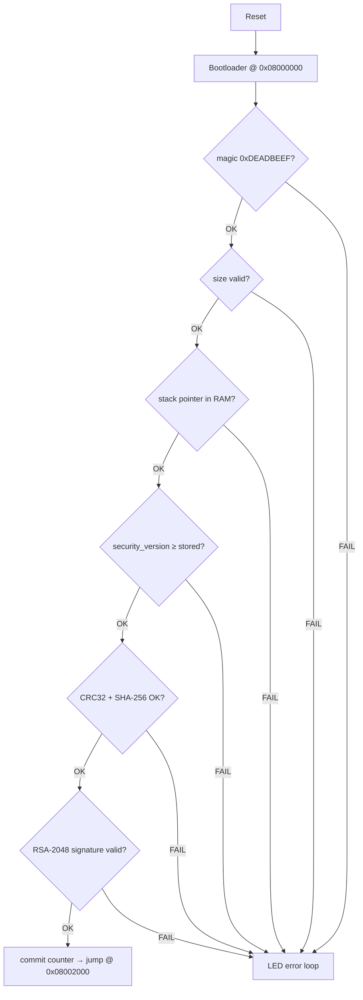

# STM32 Secure Boot & Application

> Secure boot for the STM32F103 based on an **RSA-2048 (PKCS#1 v1.5 over SHA-256)**
> firmware signature with **anti-rollback** protection, plus a control application
> exposing a **JSON / TEXT command protocol** over UART (LED, PWM, ADC).

---

## Table of contents

- [Overview](#overview)
- [Flash memory map](#flash-memory-map)
- [Bootloader: verification chain](#bootloader-verification-chain)
- [Application](#application)
- [Command protocol](#command-protocol)
- [Cryptography](#cryptography)
- [Build & sign & flash](#build--sign--flash)
- [LED indicators](#led-indicators)
- [Security scope & limitations](#security-scope--limitations)
- [Project structure](#project-structure)
- [Author](#author)

---

## Overview

The firmware is split into two independently-built images:

### 1. Bootloader (`bootloader/`)
- Located at **`0x08000000`** (8 KB).
- Verifies the **authenticity** of the application image with an **RSA-2048**
  signature (PKCS#1 v1.5 over a SHA-256 digest): only the holder of the private
  key can authorise a firmware.
- **Anti-rollback**: a monotonic `security_version` counter stored in a dedicated
  Flash page; any image with an older version is rejected.
- Low-cost integrity guards: magic number, size bounds, stack-pointer sanity,
  **CRC32**.
- Performs a clean peripheral/clock reinit and jumps into the application.

### 2. Application (`application/`)
- Located at **`0x08002000`** (56 KB region; image capped at 48 KB).
- UART command interface over **USART2**, both **JSON** and **TEXT** wire formats.
- Peripheral control: **LED** (PC13), **PWM** (TIM2 CH2 / PA1), **ADC** (ADC1 /
  PA0) read via DMA.
- Communication is **plaintext** — see [Security scope & limitations](#security-scope--limitations).

---

## Flash memory map

STM32F103C8 — 64 KB Flash (`0x08000000`–`0x0800FFFF`), 20 KB RAM.

```
┌───────────────────────────────────────────────────────────┐
│ 0x08000000  BOOTLOADER                          (8 KB)    │
│             RSA-2048 verify · anti-rollback · jump         │
├───────────────────────────────────────────────────────────┤
│ 0x08002000  APPLICATION                         (≤ 48 KB) │
│             JSON/TEXT protocol · LED / PWM / ADC           │
├───────────────────────────────────────────────────────────┤
│ 0x0800E000  FIRMWARE METADATA                   (84 B)    │
│ 0x0800E100  RSA-2048 SIGNATURE                  (256 B)   │
│ 0x0800E800  ANTI-ROLLBACK COUNTER               (1 KB pg) │
└───────────────────────────────────────────────────────────┘
```

The metadata block (`FirmwareMetadata_t`, packed) carries:

| Field              | Type        | Purpose                                   |
|--------------------|-------------|-------------------------------------------|
| `magic`            | `uint32`    | Must equal `0xDEADBEEF`                    |
| `version`          | `uint32`    | Display/semantic version                  |
| `size`             | `uint32`    | Application image size in bytes           |
| `crc32`            | `uint32`    | CRC32 of the image                        |
| `sha256`           | `uint8[32]` | SHA-256 digest of the image               |
| `timestamp`        | `uint32`    | Build timestamp                           |
| `security_version` | `uint32`    | Monotonic anti-rollback counter           |
| `reserved`         | `uint8[28]` | Padding / future use                      |

---

## Bootloader: verification chain

`Verify_Firmware()` runs the checks below, in order. Any failure stops the boot
and drives the LED error pattern in parentheses; the application is only started
when every check passes.

1. **Magic** — metadata `magic == 0xDEADBEEF` *(LED 1)*.
2. **Size** — `0 < size ≤ 0xC000` (48 KB) *(LED 2)*.
3. **Stack-pointer sanity** — the image's initial SP points into RAM
   (`(sp & 0x2FFE0000) == 0x20000000`) *(LED 5)*.
4. **Anti-rollback** — `security_version ≥` the counter stored in Flash. Checked
   *before* the expensive crypto to cut a replay short *(LED 6)*.
5. **CRC32** — recomputed over the image and compared to the metadata *(LED 2)*.
6. **SHA-256** — digest of the image is computed.
7. **RSA-2048 signature** — `rsa_pkcs1_sha256_verify()` checks that the stored
   signature covers *this* digest under the embedded public key. This is the core
   of secure boot: without the private key, a tampered image cannot be signed
   *(LED 4)*.
8. **Commit** — if the verified `security_version` has advanced, the anti-rollback
   counter is sealed to the new value (it never decreases).



---

## Application

### Clock & peripherals

| Item        | Configuration                                              |
|-------------|------------------------------------------------------------|
| **Clock**   | HSI, no PLL → **8 MHz** SYSCLK                              |
| **UART**    | **USART2**, PA2 (TX) / PA3 (RX), 115200 8N1, no flow ctrl   |
| **UART DMA**| RX: DMA1 Ch6 (circular) · TX: DMA1 Ch7                      |
| **LED**     | **PC13**, active LOW                                        |
| **PWM**     | **TIM2 CH2 / PA1**, prescaler 7 + period 999 → ~1 kHz, 0–100% |
| **ADC**     | **ADC1 channel 0 / PA0**, DMA (circular), 16-sample average |

- Voltage is derived from the ADC: `V = raw × 3.3 / 4095`.
- On startup the application blinks the LED **3×** and emits `READY`.
- A heartbeat line is emitted every 5 s: `UP:<seconds>s V:<voltage> PWM:<duty>`.

> **Note on temperature:** the `GET_TEMP` / `TEMP` commands currently return a
> fixed placeholder value (25.0 °C); the internal temperature sensor is not yet
> wired to a real ADC conversion.

---

## Command protocol

Commands are newline-terminated (`\r` or `\n`). Both formats are accepted on the
same link.

### JSON format

Shape: `{"command":"<NAME>","params":{ ... }}`

| Command        | Params            | Response (example)                                             |
|----------------|-------------------|----------------------------------------------------------------|
| `SET_LED`      | `state`: 0 or 1   | `{"status":"ok","message":"LED ON"}`                           |
| `SET_PWM`      | `duty`: 0–100     | `{"status":"ok","message":"PWM=75%"}`                          |
| `GET_TEMP`     | —                 | `{"status":"ok","temperature":25.0}`                           |
| `GET_VOLTAGE`  | —                 | `{"status":"ok","voltage":2.45,"adc_raw":3041}`                |
| `STATUS`       | —                 | `{"status":"ok","led":true,"uptime":1234,"voltage":2.45,"pwm":50}` |
| `RESET`        | —                 | `{"status":"ok","message":"Resetting..."}` then MCU reset      |

Errors are reported as `{"status":"error","message":"..."}`.

### TEXT format

| Command     | Response (example)                                      |
|-------------|---------------------------------------------------------|
| `PING`      | `PONG`                                                  |
| `STATUS`    | `STATUS: OK | LED:ON | UP:12s | V:2.45V | PWM:50%`      |
| `TEMP`      | `TEMP: 25.0°C`                                           |
| `VOLTAGE`   | `VOLTAGE: 2.45V (ADC:3041)`                             |
| `LED=1`     | `OK: LED ON`  (`LED=0` → `OK: LED OFF`)                 |
| `PWM=75`    | `OK: PWM=75%`  (out of 0–100 → `ERROR: PWM 0-100`)      |
| `RESET`     | `RESETTING...` then MCU reset                           |

Unknown commands return `ERROR: Unknown '<cmd>'` (TEXT) or an error JSON object.

---

## Cryptography

All primitives used by the bootloader are **bare-metal, self-contained**
implementations (no external TLS stack):

| Primitive              | Implementation                              | Role                                   |
|------------------------|---------------------------------------------|----------------------------------------|
| **RSA-2048 PKCS#1 v1.5** | `bootloader/lib/crypto/rsa_light.c` (Montgomery arithmetic) | Firmware **authenticity** (secure boot) |
| **SHA-256**            | `bootloader/lib/crypto/crypto_light.c`      | Signed digest + integrity              |
| **CRC32**              | software / STM32 hardware                   | Low-cost integrity guard               |
| **Anti-rollback**      | `bootloader/lib/boot/antirollback.c`        | Monotonic version counter in Flash     |

- The **public** key is embedded in `bootloader/include/rsa_public_key.h`,
  generated by `tools/rsa_keygen.py`.
- The **private** key is kept out of the repository and is required only to sign.

---

## Build & sign & flash

The firmware is built with **PlatformIO**. Two environments: `bootloader` and
`application`.

### Automated workflow

```bash
cd application
./secure_boot_deploy.sh      # builds bootloader + application, signs, and flashes
```

### Manual steps

```bash
# 1. Generate an RSA-2048 keypair and the embedded public-key header (once)
cd bootloader
python tools/rsa_keygen.py

# 2. Build the bootloader (must fit in 8 KB) and flash it at 0x08000000
pio run -e bootloader
pio run -e bootloader --target upload

# 3. Build the application
cd ../application
pio run -e application

# 4. Sign the application image → writes metadata + RSA-2048 signature
python tools/firmware_signer.py

# 5. Flash the (signed) application at 0x08002000
pio run -e application --target upload
```

> **Flash order matters:** always flash the bootloader first. The application is
> linked at `0x08002000` with `VECT_TAB_OFFSET=0x2000`.

---

## LED indicators

The onboard LED (PC13) reports both boot progress and error conditions.

**Boot sequence (bootloader):** 2 short blinks on entry; 3 longer blinks before
the jump when verification succeeds.

**Error codes** (`LED_Error_Loop`): the pattern number maps to the failed check.

| Code | Meaning                         |
|------|---------------------------------|
| 1    | Invalid magic                   |
| 2    | Invalid size / CRC32 mismatch   |
| 3    | SHA-256 failure                 |
| 4    | Invalid RSA-2048 signature      |
| 5    | Invalid stack pointer           |
| 6    | Anti-rollback (version refused) |

---

## Security scope & limitations

What this firmware **does** provide:

- **Verified, authentic boot**: the application cannot run unless it carries a
  valid RSA-2048 signature over its SHA-256 digest.
- **Anti-rollback**: a signed-but-older image is rejected.
- **Integrity guards**: magic / size / stack-pointer / CRC32 checks.

What it **does not** (yet) provide — do not assume these:

- **No encryption or authentication on the UART link.** Commands and responses
  are sent in **plaintext** (JSON / TEXT). There is no AES, HMAC, session, or
  replay protection at the application-protocol level.
- **No flash read protection**: RDP is at Level 0 (development); debug (SWD) is
  open. For production, enable RDP, lock debug, and use per-device keys stored in
  protected memory.

Risk analysis: the technical threat model (menaces ↔ tests) is in
[`THREAT_MODEL.md`](THREAT_MODEL.md); a system-level risk analysis following the
**EBIOS Risk Manager (ANSSI)** method is in [`EBIOS_RM.md`](EBIOS_RM.md).

---

## Project structure

```
firmware/
├── bootloader/                      # Secure boot (8 KB @ 0x08000000)
│   ├── src/main.c                   # Verify_Firmware() + jump
│   ├── include/
│   │   ├── crypto_light.h
│   │   └── rsa_public_key.h         # embedded public key (generated)
│   ├── lib/
│   │   ├── boot/antirollback.{c,h}
│   │   └── crypto/{crypto_light,rsa_light}.{c,h}
│   ├── tools/                       # rsa_keygen.py, firmware_signer.py, rsa_c_key.py
│   ├── test/                        # unit + integration (pytest)
│   └── platformio.ini
│
├── application/                     # Control application (@ 0x08002000)
│   ├── src/main.c                   # USART2 + JSON/TEXT + LED/PWM/ADC
│   ├── tools/                       # firmware_signer.py, pre/post_build.py, rsa_keygen.py
│   ├── secure_boot_deploy.sh        # build + sign + flash
│   ├── test/
│   └── platformio.ini
│
├── THREAT_MODEL.md                  # technical threat model (STRIDE-style, test-backed)
└── EBIOS_RM.md                      # EBIOS Risk Manager (ANSSI) risk analysis
```

---

## Author

**Bechir Yengui** — [github.com/BechirYengui](https://github.com/BechirYengui)
